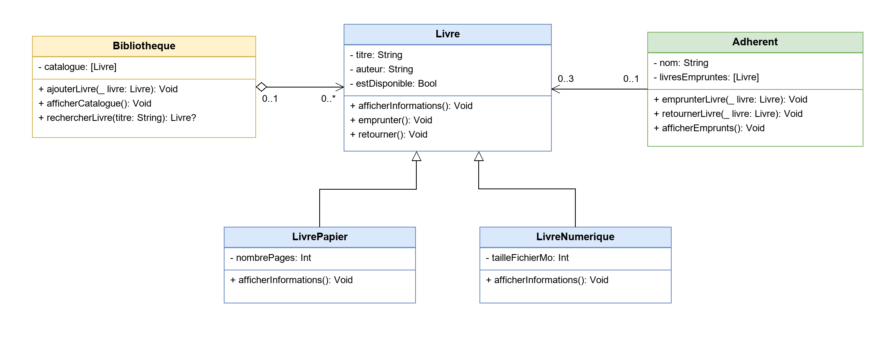

# Rapport de Projet — Système de Gestion de Bibliothèque en Swift

**Réalisé par :** BEAUCHARD Woodney Beker, GEORGES Sandasha, PIERRE Friztnel  
**Date :** 25 novembre 2026  
**Langage & Outils :** Swift 6.3.3, PowerShell, draw.io (UML)

---

## 1. Introduction et Objectifs

Ce projet consiste à concevoir et implémenter en **Swift** une application console interactive de gestion de bibliothèque en appliquant les principes fondamentaux de la **Programmation Orientée Objet (POO)** :

- **Encapsulation et validation** : attributs déclarés `private` et manipulés via des accesseurs/mutateurs contrôlant la validité des données (nombre de pages `> 0`, taille de fichier `> 0`).
- **Héritage et spécialisation** : une classe mère `Livre` déclinée en deux sous-classes spécialisées `LivrePapier` et `LivreNumerique`.
- **Polymorphisme** : redéfinition (`override`) de la méthode `afficherInformations()` afin d'adapter l'affichage à la nature exacte de chaque ouvrage du catalogue.
- **Règles métier** : gestion de l'unicité d'emprunt (`estDisponible`), plafond de **3 emprunts simultanés** par adhérent, et recherche par titre insensible à la casse.

---

## 2. Architecture et Conception UML

### 2.1 Diagramme de classes



*Figure 1 — Diagramme de classes UML du système de bibliothèque.*

### 2.2 Description des classes et des relations

| Classe | Responsabilité principale | Attributs privés | Méthodes métier |
| --- | --- | --- | --- |
| `Livre` | Représente un ouvrage générique et son état de disponibilité | `titre: String`, `auteur: String`, `estDisponible: Bool` | `afficherInformations()`, `emprunter()`, `retourner()` |
| `LivrePapier` | Spécialise `Livre` pour les ouvrages imprimés | `nombrePages: Int` | `afficherInformations()` (redéfinie) |
| `LivreNumerique` | Spécialise `Livre` pour les ouvrages dématérialisés | `tailleFichierMo: Int` | `afficherInformations()` (redéfinie) |
| `Bibliotheque` | Centralise le catalogue des livres | `catalogue: [Livre]` | `ajouterLivre(_:)`, `afficherCatalogue()`, `rechercherLivre(titre:)` |
| `Adherent` | Représente un usager et ses emprunts en cours | `nom: String`, `livresEmpruntes: [Livre]` | `emprunterLivre(_:)`, `retournerLivre(_:)`, `afficherEmprunts()` |

#### Justification des relations et des cardinalités
1. **Agrégation `Bibliotheque` (`0..1`) ◇──> (`0..*`) `Livre`** : une bibliothèque regroupe zéro ou plusieurs livres dans son `catalogue`. Il s'agit d'une agrégation (losange blanc) car une instance de `Livre` peut être créée et exister indépendamment d'une instance de `Bibliotheque`.
2. **Association `Adherent` (`0..1`) ──> (`0..3`) `Livre`** :
   - Côté `Livre` (`0..3`) : la méthode `emprunterLivre(_:)` vérifie `livresEmpruntes.count < 3`, limitant chaque adhérent à 3 livres empruntés simultanément.
   - Côté `Adherent` (`0..1`) : lorsqu'un livre est emprunté, `estDisponible` passe à `false`, empêchant tout autre adhérent de l'emprunter simultanément. Un livre est donc détenu par 0 ou 1 adhérent à un instant donné.
3. **Héritage `LivrePapier` ──▷ `Livre` et `LivreNumerique` ──▷ `Livre`** : les deux sous-classes héritent des propriétés et comportements d'emprunt/retour de `Livre`.

---

## 3. Fonctionnement de l'Interface Interactive (`main.swift`)

Le programme compile l'ensemble des fichiers sources Swift en un exécutable `program.exe` :

```powershell
swiftc Livre.swift LivrePapier.swift LivreNumerique.swift Bibliotheque.swift Adherent.swift main.swift -o program.exe
.\program.exe
```

Une boucle interactive présente le menu suivant et sécurise les saisies utilisateur (chaînes non vides, entiers strictement positifs, sélection indexée des adhérents) :

- `1.` Afficher le catalogue complet (polymorphisme sur `Livre`, `LivrePapier`, `LivreNumerique`)
- `2.` Rechercher un livre par titre (insensible à la casse)
- `3.` Ajouter un livre (standard, papier ou numérique)
- `4.` Créer un adhérent (avec vérification d'unicité du nom)
- `5.` Emprunter un livre
- `6.` Retourner un livre
- `7.` Afficher les emprunts d'un adhérent
- `0.` Quitter

---

## 4. Validation et Jeux de Tests (Captures d'exécution)

Les captures ci-dessous illustrent l'exécution réelle du programme dans le terminal PowerShell sur les scénarios de test demandés :

### 4.1 Création de la bibliothèque et ajout d'au moins trois livres


*Figure 2 — Compilation, initialisation de la bibliothèque (5 ouvrages initiaux) et ajout d'un livre papier.*


*Figure 3 — Ajout d'un livre numérique (34 Mo).*


*Figure 4 — Ajout d'un livre standard.*

### 4.2 Création d'un adhérent


*Figure 5 — Création de l'adhérent « Beker » et vérification de sa présence dans la liste.*

### 4.3 Emprunt d'un livre et refus sur un livre déjà emprunté


*Figure 6 — Emprunt réussi du livre « numerique » par l'adhérent Beker.*


*Figure 7 — Tentative d'emprunt du livre « numerique » par Bob refusée car l'ouvrage est déjà emprunté.*

### 4.4 Affichage des livres empruntés et retour d'ouvrage


*Figure 8 — Consultation des emprunts (Charlie : aucun emprunt ; Beker : « numerique ») et procédure de retour.*

---

## 5. Conclusion

Le système répond à l'ensemble du cahier des charges fonctionnel et technique : séparation claire des responsabilités en 5 classes métier, respect strict de l'encapsulation, exploitation du polymorphisme pour le catalogue hétérogène et validation interactive complète des règles de gestion des emprunts.
